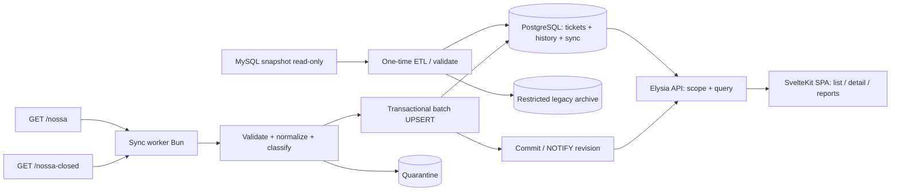
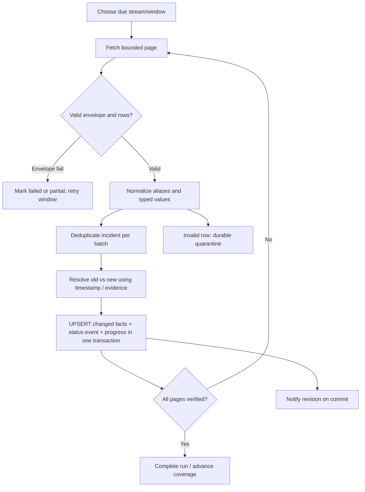

# Architecture — DOMPIS Rewrite

## Kebijakan v1.3 (berlaku atas seluruh dokumen)
Pemilik mengizinkan agent lokal mengakses MySQL dan PostgreSQL, read dan write. Akses aktual bergantung pada credential, jaringan, privilege dan sandbox agent; jangan mengakali kontrol. Gunakan Database-Access.md sebagai kebijakan otoritatif. Read produksi yang ringan dan write rutin terukur dalam target yang telah didaftarkan tidak memerlukan konfirmasi per query. Operasi produksi berisiko tinggi, perubahan schema produksi, bulk correction, freeze/cutover dan tindakan irreversible memerlukan persetujuan runbook khusus. Source legacy tetap read-only; database bukan source code. Discovery tidak mengubah data bisnis produksi. Semua rancangan teknis termasuk DDL, jumlah tabel/index dan alias adalah kandidat, bukan kontrak tetap. Direct matching Workzone diutamakan; buktikan keunikan global setelah normalisasi, jika ambigu gunakan pembeda yang terverifikasi, jangan menebak. Alias hanya bila terbukti diperlukan. Requirement bisnis, integritas historis, keamanan dan stack tetap wajib. Lihat Discovery-Protocol.md dan Decision-Log.md.


## 1. Arsitektur target
Modular monolith, satu repository, dua proses Bun (API dan sync worker), satu PostgreSQL; static SvelteKit SPA dilayani reverse proxy. Jangan menambah Redis, BullMQ, microservice, event broker atau cache query global pada MVP. Tambah hanya setelah profiling dan ADR. PostgreSQL adalah authoritative store; endpoint NOSSA authoritative untuk fakta ticket baru/terverifikasi; baseline historis dari migrasi sekali jalan MySQL.



## 2. Repo dan boundaries
```
apps/web/src/routes/{login,tickets,semesta,rekap-workorder,detail-wo-hi,settings}
apps/web/src/lib/{api,components,features,stores}
apps/api/src/{index,plugins,modules/{auth,tickets,reports,admin,sync-status}}
apps/worker/src/{index,scheduler,nossa,normalize,reconcile,write,backfill}
packages/db/src/{schema,client,repositories}; packages/db/drizzle/
packages/domain/src/{ticket,classification,sla,metrics,scope}
packages/contracts/src/{dto,validation}
packages/testing/{fixtures,golden}; tests/{integration,e2e,load}
ops/{systemd,nginx,backup}; docs/; AGENTS.md
```
Bun workspaces, lockfile committed; Drizzle migrations generated/reviewed, raw SQL only for measured queries/constraints/partial index. Elysia runtime schema validation and response projection; domain pure TS no database or framework imports; repos take authorized scope mandatory; UI never imports DB. Use a single supported Drizzle PostgreSQL driver chosen via compatibility test with Bun; separate bounded pools, no pool per request. PostgreSQL major and Bun/package versions pinned after verification, no guessed version compatibility.

## 3. Sync pipeline detail
Existing source contract in `lib/external-db/qosmic-bridge/{nossa,types,window-planner,client}.ts`: endpoints /nossa and /nossa-closed; offset+limit max page 1000, offset ceiling 5000, closed date window max 31 days; internal default window 7 days; second precision supported per code; no batch incident endpoint; response meta.count is page count NOT total. Validate resource, ok, array, metadata and date filter behavior against fixtures. Field list dynamic. No guessed updated_since/cursor API. Use base URL allowlist and server secret bearer/token according to verified legacy client.

Single scheduler (one worker instance) owns ALL upstream requests, including optional manual incident lookups. Documented upstream cap 50/min per key (configurable); local conservative cap initial 20/min per key; use rolling window with reserved live 14/backfill <=6, lower if operator config; retry attempts also consume budget. Persist rate tokens or conservatively wait 60s on restart; no other clients sharing key without common budget. Single in-flight fetch default; priority live > manual > backfill, fairness closed vs open; request deadline 15s, Retry-After and jittered exponential backoff 429/502/503/504/52x/network; 401/422 pause/config error, no retry storm. No external call while transaction held. Stop graceful on SIGTERM, abort network, rollback or finish batch. PG advisory lock on dedicated session for worker singleton; fail-stop when session lost; do not force-clear locks. Transaction row lock serializes writer; only worker DB role writes canonical data during runtime; approved ETL migrator may write during isolated migration mode, never concurrently without explicit locking protocol.



Open stream (not an open-status guarantee) scans all statuses (no hard-coded status whitelist upstream), without reliance on sync_date. When cap reached split date windows per legacy where supported; never silently truncate. Closed rolling overlap (yesterday to tomorrow WIB per old implementation, adjusted after date semantics verified); reconcile last 14 days off-peak in budget. Backfill chunk 7 days max, recursively bisect overflow through seconds; if one-second window still overflows mark incomplete and escalate. Backfill start >= 2026-01-01 per legacy contract; no guarantee older data. Dates internally [from,to); test inclusive/exclusive mapping to API and add overlap if needed. Offset pagination on mutable dataset may skip rows; periodic overlapping scans and reconciliation; no guarantee exhaustive if API ordering unstable. No absence-based close/delete. Missing open remains last-known open and optionally flagged for targeted lookup with spare budget. Source freshness is per scan, not per last change.

Run records status running/succeeded/partial/failed; only mark complete after all pages processed and row rejects durably recorded; any rejected required row marks partial until corrected or explicitly acknowledged by operator, not silently skipped. Persist page progress for audit; restart unfinished mutable window from offset 0 (not resume stale offset). Closed historical checkpoint advances only contiguous verified windows; live uses overlap not a fake update cursor. Quarantine bounded payload, retention, replay after fix via same writer.

## 4. Conflict policy and canonical writes
Identity = trimmed uppercase incident (validate actual format); UNIQUE incident. `source_endpoint` indicates winning observation, not identity. Normalize alias mapping from old `normalizer.ts` (Source, Regional, RK, Induk_Gamas, Last_Update_Ticket, C_RESOLVE_DATE, C_BOOKING_DATE, etc). Date offset provided -> honor; no offset -> Asia/Jakarta only after verified. Booking string YYYY-MM-DD HH:mm:ss.S must use strict parser, never runtime timezone defaults. Explicit null distinct from missing; absent field never erases known field; explicit null clears only documented authoritative field. Hash deterministic accepted upstream facts excluding legacy-only fields and fetch time, keys ordered, null normalization; compare canonical state separately; do not hash raw JSON order. `source_updated_at` uses verified Last_Update_Ticket; status_date for status evidence only, generated_at/fetch time not source modification. Preserve original status and canonical lifecycle. Rules:

| Incoming evidence | Action |
|---|---|
| Same normalized facts | No-op, do not rewrite ticket/history/indexes |
| Comparable newer source version/time | Apply authoritative present fields; newer open permits reopen, clear old current closed_at when verified |
| Comparable older | Ignore current state; log counts |
| Equal timestamp, conflicting status | Do not choose by fixed CLOSED priority; quarantine conflict, schedule bounded incident verification |
| Missing/uncomparable timestamps | First valid insert OK; merge only safe missing non-status values after validation; conflicting state requires explicit verification, no blind overwrite |
| Verified closed with no closure date | Keep lifecycle closed only if contract supports status; closed_at null, exclude time-based closure metric, mark quality |

Incoming rows deduplicated using same conflict rule before SQL; no PostgreSQL multi-row conflict touching same incident twice. Sort by incident for consistent locking. In short transaction (start 200–500 rows): SELECT existing needed fields FOR UPDATE; canonical merge in domain; insert/update changed rows using `ON CONFLICT (incident) DO UPDATE` with guarded version/hash predicates; write status history for actual transition only (including reopen); bump singleton revision once per changed batch, pg_notify compact revision in transaction. Retain version monotonic per incident; checkpoint page progress same transaction. No `ticket_raw` archive full copy, no separate projection daemon; inline deterministic projection. Optional local annotations never overwritten by ingestion. Source data validation and classification version recorded; reclassify via bounded explicit maintenance, not nightly full scan.

## 5. Query model
API all predicates built from validated filter DTO + scope. Date ranges computed once in WIB converted to timestamptz; never `DATE(column)` in WHERE. SELECT explicit columns, keyset `(reported_at,id)` or `(closed_at,id)` with matching indexes; encode cursor sort/filter/scope signature; null timestamps excluded in default date list, anomaly endpoint separate. For daily, UNION ALL disjoint open and closed-today with outer order/limit when planner benefits, no per-ticket N+1. Use fixed sort whitelist; parameter binding Drizzle; no SQL string concatenation. Incident exact, service_no exact; no broad `%term%` default. Use `COUNT(*) FILTER` and grouped dimension rows; don't pull all ticket rows into Bun to count. Same `eligibleTickets` predicate for overview, lists and rekap drilldown; for consistent multi-query response use short repeatable-read or single SQL. Cross-request data changes expected: return revision/asOf, refresh on mismatch, do not claim snapshot isolation over multiple pages. Historical reports bounded range (default 7d max 31d interactive); precompute only when measured bottleneck. See Database.md.

## 6. Freshness and UI events
API `GET /api/v1/sync/status` and `GET /api/v1/events` SSE. Dedicated LISTEN connection (not transaction pooled) subscribes `ticket_revision`; NOTIFY delivery best-effort; on connect/reconnect read revision and refetch; heartbeat 25s, coalesce client refetch 5–10s, visible tab only, fallback 30s. Event contains revision only, no incident/PII; scope still checked on every API fetch. Session expiry/revocation closes stream within bounded interval; no shared cache across scopes. One overview request for sidebar; inactive tabs not fetched. Optional small per-process TTL cache only after profiling (key includes user/scope version, normalized filters, rules, revision; bounded memory). No Redis dependency. UI is near-real-time local commit, not upstream push.

## 7. HTTP contract
| Method/path (prefix /api/v1) | Contract |
|---|---|
| POST /auth/login, POST /auth/logout, GET /auth/me | cookie session, CSRF protections; no password in logs |
| GET /tickets | mode=daily/history, from/to, bucket, dept, areaId, regionId, branchId, serviceAreaId, workzoneIds, status, incident/serviceNo, limit, cursor, sort whitelist |
| GET /tickets/:uuid | scoped detail + status history, local notes if enabled |
| GET /tickets/overview | same daily predicate, counts by bucket/segment/flags |
| GET /reports/semesta | same historical predicates, counts/trends |
| GET /reports/rekap | daily aggregate per scope/dimension, hourly close |
| GET /reports/rekap/members | same cell spec converted to list predicate |
| GET /reports/wo-hi | same daily predicate with dedicated DTO |
| GET /exports/tickets | bounded CSV scoped stream |
| GET /sync/status, GET /events | freshness metadata and revision |
| /api/admin/users, /api/admin/users/:id/scopes | privileged management; audit |
| GET /api/admin/organization/child-impact | superadmin-only read-only preview of users whose parent/global scope would include a proposed child |
| /organization/{areas,regions,branches,service-areas,workzones} | authorized cascading options |

Response `{data, meta:{requestId,asOf,revision,nextCursor?,freshness}}`; errors `{error:{code,message},requestId}`. 400 invalid filter, 401 unauthenticated, 403 forbidden operation, 404 inaccessible record, 429 rate limit, 503 timeout/degraded with Retry-After. No raw SQL/stack. Request ID generated server; reject invalid untrusted forwarded headers.

## 8. Deployment and observability
Reverse proxy TLS same origin `/api/` to Bun Elysia (SSE buffering off); static SPA fallback only non-API routes. API + worker systemd services non-root, restart on fatal exception, readiness vs liveness separated, SIGTERM clean shutdown. PG private network dedicated CT/VM; preferably SSD, backup off-host. Initial pool API 8–12, worker 2–4, listen 1, maintenance separate; tune to measured disk latency. API statement timeout list 2s, reports 5s, lock timeout 1s, export separate max and concurrency; worker small chunks, backoff on overload. Configure PostgreSQL roles/timeouts; no unlimited pools. No remote DB from browser. Metrics: fetch/page/run counts, 429, completeness, rows accepted/ignored/conflicted, last successful per source, source-to-commit lag, DB query p95, pool wait, locks, WAL, dead tuples, disk IOPS, SSE connections and UI errors. Structured logs with request/run ID, no payload/PII. Alert after 2 missed planned cycles, disk >80%, or unresolved conflicts; thresholds adjustable. Security.md and Migration.md mandatory.

## v1.0 authoritative sync supplement
Read Sync-Engine.md for concrete algorithm, coverage and tie handling; Data-Contract.md overrides earlier assumptions. /nossa sample contains CLOSED, MEDIACARE, FINALCHECK and RESOLVED. Endpoint identity cannot decide lifecycle.

## 10. One-time migration lane (v1.3)
`scripts/migration/{extract-legacy,transform-ticket,migrate-masters,migrate-users-scopes,migrate-aliases,validate-scope,import-tickets,validate-migration,reconcile-tickets}.ts` is a CLI tool, not a third permanent worker. Read a verified MySQL restore/snapshot using read-only credentials; stream keyset batches by id_ticket. Shared domain functions validate target; a distinct legacy adapter preserves provenance rather than fabricating source fields. Acquire same singleton writer advisory lock as sync; worker paused for bulk import/final delta; no HTTP while transaction holds locks. Each commit includes canonical tickets, cold archive ID mapping and durable checkpoint; failed row handling and idempotency per Migration.md. Reconcile via approved NOSSA windows after import. Runtime does not import legacy adapter or connect to MySQL; production migration credentials revoked after cutover. Do not create historical events from one current snapshot.

## v1.3 organization, access and greenfield boundaries
`area → region → branch → service_area → workzone → tickets`; users grant at any of the five levels via `user_scopes`. Server resolves allowed workzone IDs as a relational subquery, then uses shared mandatory scoped predicate for every operational route. No large ticket-table joins to grant rows that duplicate counts, no hard-coded region/branch lists. Master API `/api/v1/organization/{areas,regions,branches,service-areas,workzones}` returns scoped choices; privileged admin mutations and `/api/v1/admin/users/:id/scopes` require explicit permission + audit. Resolve exact NOSSA triplet with approved `workzone_source_aliases` per batch, not per-ticket query. Unknown scope remains NULL; no guessed assignment. Shared `packages/domain/src/scope`, `packages/db/src/repositories/organization` and `apps/api/src/modules/admin/organization` own these boundaries. Migration CLI adds `migrate-masters`, `migrate-users-scopes`, `validate-scope`, `migrate-aliases`; no runtime dependency on legacy. See Organization-Scope.md and Master-Data-Migration.md. Scope changes and hierarchy moves invalidate sessions' effective access, SSE and cursor scope fingerprint. Do not keep old permissions in client JWT or URL. No separate authorization service, closure table or denormalized ancestor keys at MVP. Legacy path `/Users/pakbreng/Projects/dompis_v2` is only read-only source for Phase 0; new project separately located. Query and code implementations must be newly designed per Query-Standards.md.
