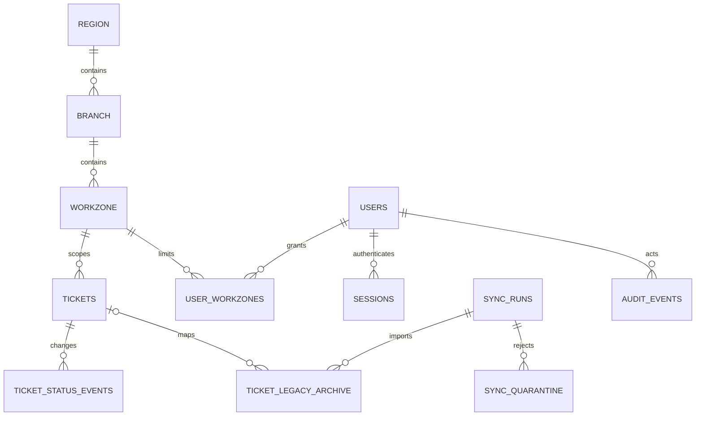

# Database — PostgreSQL canonical model

Status: proposal v1.1. SQL below is a migration blueprint, not executed. All entity PK and FK UUID native; ticket incident is unique natural key, never PK. PostgreSQL 18 `uuidv7()` default recommended for locality; UUIDv7 is not an authorization mechanism. For PG <18 choose app UUIDv7 or `gen_random_uuid()` and revise all defaults. No time-partitioning tickets initially (global uniqueness of incident is critical); consider history partition only at measured volume. Avoid converting every legacy varchar/index blindly. Preserve unknown as null, not invented values. No permanent `ticket_raw` duplicate, no live source snapshot per ticket, no projection request queue. One restricted legacy archive is permitted for migration fidelity and ID mapping.

## 1. ERD

Region/branch/SA/workzone mapping is a locally approved dimension, not a second source of ticket facts. Workzone code uniqueness must be verified globally; if reused, use `(branch_id,code)` and resolve mapping from source region/witel, not code alone. Unmapped tickets visible only to explicit privileged review. `tickets` is current state, history records transitions; optionally separate restricted PII payload table if profiling/access requires, not mandatory. The schema includes `sync_revision`, singleton logical key unique, and `sync_checkpoints` per stream/window. Local notes not in MVP. Rule config versioned TS + fixtures, not dynamic unreviewed SQL.

## 2. DDL candidate
```sql
-- FINAL BLUEPRINT v1.1 — IMPLEMENTATION CANDIDATE; PostgreSQL 18; not executed or production validated.
CREATE TABLE regions (
 id uuid PRIMARY KEY DEFAULT uuidv7(), code text NOT NULL UNIQUE, name text NOT NULL
);
CREATE TABLE branches (
 id uuid PRIMARY KEY DEFAULT uuidv7(), region_id uuid NOT NULL REFERENCES regions(id),
 code text NOT NULL, name text NOT NULL, UNIQUE(region_id,code)
);
CREATE TABLE workzones (
 id uuid PRIMARY KEY DEFAULT uuidv7(), branch_id uuid NOT NULL REFERENCES branches(id),
 code text NOT NULL, name text NOT NULL, service_area text,
 UNIQUE(branch_id,code)
);
CREATE TABLE users (
 id uuid PRIMARY KEY DEFAULT uuidv7(), username text NOT NULL UNIQUE,
 display_name text NOT NULL, password_hash text NOT NULL,
 role text NOT NULL CHECK(role IN ('superadmin','admin','helpdesk','viewer')),
 global_scope boolean NOT NULL DEFAULT false, active boolean NOT NULL DEFAULT true,
 scope_version bigint NOT NULL DEFAULT 1,
 created_at timestamptz NOT NULL DEFAULT now(), updated_at timestamptz NOT NULL DEFAULT now(),
 CHECK(username=lower(btrim(username)))
);
CREATE TABLE user_workzones (
 id uuid PRIMARY KEY DEFAULT uuidv7(), user_id uuid NOT NULL REFERENCES users(id) ON DELETE CASCADE,
 workzone_id uuid NOT NULL REFERENCES workzones(id), UNIQUE(user_id,workzone_id)
);
CREATE TABLE sessions (
 id uuid PRIMARY KEY DEFAULT uuidv7(), user_id uuid NOT NULL REFERENCES users(id) ON DELETE CASCADE,
 token_hash bytea NOT NULL UNIQUE, created_at timestamptz NOT NULL DEFAULT now(),
 expires_at timestamptz NOT NULL, revoked_at timestamptz,
 CHECK(expires_at>created_at)
);
CREATE TABLE tickets (
 id uuid PRIMARY KEY DEFAULT uuidv7(),
 incident text NOT NULL UNIQUE CHECK(incident=upper(btrim(incident)) AND incident ~ '^[A-Z0-9_-]{1,100}$'),
 workzone_id uuid REFERENCES workzones(id), source_workzone text, source_witel text, source_region text,
 status text NOT NULL, lifecycle text NOT NULL CHECK(lifecycle IN ('open','closed','unknown')),
 data_origin text NOT NULL CHECK(data_origin IN ('legacy','nossa','nossa_closed')),
 migrated_at timestamptz, first_source_seen_at timestamptz,
 source_endpoint text CHECK(source_endpoint IN ('nossa','nossa_closed')),
 reported_at timestamptz, status_at timestamptz, booking_at timestamptz,
 resolved_at timestamptz, closed_at timestamptz, source_updated_at timestamptz,
 source_ticket text, channel text, source_segment smallint, service_id text, classification_id text, classification_flag text, classification_path text,
 customer_segment text, customer_type text, service_type text, service_no text,
 jenis_tiket_1 text, jenis_tiket_2 text,
 operational_bucket text NOT NULL CHECK(operational_bucket IN ('kpi_customer','kpi_proactive','non_kpi_unspec','non_technical','sqm_update','obsolete','unknown')),
 kpi_seg text NOT NULL CHECK(kpi_seg IN ('b2c','b2b','netral','unknown')),
 guarantee_status text, gamas_incident text, owner_group text, summary text,
 source_district text, source_tif_region text, technology text, realm text,
 is_obsolete boolean, gaul_count integer CHECK(gaul_count>=0),
 last_work_log_at timestamptz, source_inserted_at timestamptz,
 ttr_customer_raw numeric, ttr_end_to_end_raw numeric, ttr_pending_raw numeric, ttr_slg_raw numeric,
 actual_solution text, solution_code text, solution_segment text, reported_by text,
 symptom text, pending_reason text, sqm_update_reason text,
 flagging_manja text, flagging_datin text, needs_validation boolean NOT NULL DEFAULT false,
 validation_reason text, sla_seconds integer CHECK(sla_seconds>0),
 ttr_deadline_at timestamptz, ttr_comply_status text CHECK(ttr_comply_status IN ('comply','not_comply')),
 rule_version text NOT NULL, quality_flags text[] NOT NULL DEFAULT '{}',
 detail jsonb NOT NULL DEFAULT '{}'::jsonb CHECK(jsonb_typeof(detail)='object'),
 source_hash bytea CHECK(octet_length(source_hash)=32),
 version bigint NOT NULL DEFAULT 1 CHECK(version>0),
 created_at timestamptz NOT NULL DEFAULT now(), updated_at timestamptz NOT NULL DEFAULT now(),
 CHECK(lifecycle<>'open' OR closed_at IS NULL),
 CHECK((data_origin='legacy' AND migrated_at IS NOT NULL) OR (data_origin<>'legacy' AND migrated_at IS NULL)),
 CHECK((source_endpoint IS NULL AND source_hash IS NULL AND first_source_seen_at IS NULL AND data_origin='legacy') OR
       (source_endpoint IS NOT NULL AND source_hash IS NOT NULL AND first_source_seen_at IS NOT NULL))
);
CREATE TABLE ticket_status_events (
 id uuid PRIMARY KEY DEFAULT uuidv7(), ticket_id uuid NOT NULL REFERENCES tickets(id),
 ticket_version bigint NOT NULL, from_status text, to_status text NOT NULL,
 from_lifecycle text, to_lifecycle text NOT NULL,
 effective_at timestamptz, observed_at timestamptz NOT NULL DEFAULT now(),
 source_endpoint text NOT NULL CHECK(source_endpoint IN ('nossa','nossa_closed')),
 UNIQUE(ticket_id,ticket_version)
);
CREATE TABLE sync_runs (
 id uuid PRIMARY KEY DEFAULT uuidv7(), stream text NOT NULL CHECK(stream IN ('open','closed','backfill','lookup','legacy_migration')),
 status text NOT NULL CHECK(status IN ('running','succeeded','partial','failed')),
 window_from timestamptz, window_to timestamptz,
 started_at timestamptz NOT NULL DEFAULT now(), finished_at timestamptz,
 pages integer NOT NULL DEFAULT 0, fetched bigint NOT NULL DEFAULT 0,
 inserted bigint NOT NULL DEFAULT 0, updated bigint NOT NULL DEFAULT 0,
 unchanged bigint NOT NULL DEFAULT 0, stale bigint NOT NULL DEFAULT 0,
 rejected bigint NOT NULL DEFAULT 0, error_code text,
 CHECK(window_to IS NULL OR window_from<window_to)
);
-- Cold archive / ID mapping for a single approved MySQL ticket dataset.
-- One source row per legacy ID, including unresolved rows; never queried by normal lists.
CREATE TABLE ticket_legacy_archive (
 id uuid PRIMARY KEY DEFAULT uuidv7(),
 legacy_ticket_id bigint NOT NULL UNIQUE,
 ticket_id uuid REFERENCES tickets(id),
 run_id uuid NOT NULL REFERENCES sync_runs(id),
 legacy_payload jsonb NOT NULL CHECK(jsonb_typeof(legacy_payload)='object'),
 disposition text NOT NULL CHECK(disposition IN ('imported','merged','quarantined','excluded')),
 reason_code text,
 row_hash bytea NOT NULL CHECK(octet_length(row_hash)=32),
 migrated_at timestamptz NOT NULL DEFAULT now(),
 CHECK((disposition IN ('imported','merged') AND ticket_id IS NOT NULL) OR
       (disposition IN ('quarantined','excluded') AND ticket_id IS NULL)),
 CHECK(disposition='imported' OR reason_code IS NOT NULL)
);
CREATE INDEX ticket_legacy_archive_ticket ON ticket_legacy_archive(ticket_id) WHERE ticket_id IS NOT NULL;
CREATE TABLE sync_checkpoints (
 id uuid PRIMARY KEY DEFAULT uuidv7(), stream text NOT NULL UNIQUE,
 covered_until timestamptz, last_success_at timestamptz, last_attempt_at timestamptz,
 last_run_id uuid REFERENCES sync_runs(id), state jsonb NOT NULL DEFAULT '{}'::jsonb
);
CREATE TABLE sync_quarantine (
 id uuid PRIMARY KEY DEFAULT uuidv7(), run_id uuid NOT NULL REFERENCES sync_runs(id),
 incident text, reason text NOT NULL, fingerprint bytea NOT NULL,
 payload jsonb, created_at timestamptz NOT NULL DEFAULT now(), resolved_at timestamptz,
 UNIQUE(run_id,fingerprint,reason)
);
CREATE TABLE sync_revision (
 id uuid PRIMARY KEY DEFAULT uuidv7(), singleton boolean NOT NULL UNIQUE DEFAULT true CHECK(singleton),
 revision bigint NOT NULL DEFAULT 0, updated_at timestamptz NOT NULL DEFAULT now()
);
INSERT INTO sync_revision DEFAULT VALUES;
CREATE TABLE audit_events (
 id uuid PRIMARY KEY DEFAULT uuidv7(), actor_id uuid REFERENCES users(id) ON DELETE SET NULL,
 action text NOT NULL, target_id uuid, request_id text NOT NULL,
 metadata jsonb NOT NULL DEFAULT '{}'::jsonb, created_at timestamptz NOT NULL DEFAULT now()
);

-- Incident lookup already covered by UNIQUE; no duplicate index.
CREATE INDEX tickets_open_scope_reported ON tickets(workzone_id,reported_at DESC,id DESC)
 WHERE lifecycle='open' AND reported_at IS NOT NULL;
CREATE INDEX tickets_open_global_reported ON tickets(reported_at DESC,id DESC)
 WHERE lifecycle='open' AND reported_at IS NOT NULL;
CREATE INDEX tickets_closed_scope_date ON tickets(workzone_id,closed_at DESC,id DESC)
 WHERE lifecycle='closed' AND closed_at IS NOT NULL;
CREATE INDEX tickets_history_scope_date ON tickets(workzone_id,reported_at DESC,id DESC)
 WHERE reported_at IS NOT NULL;
CREATE INDEX tickets_history_date ON tickets(reported_at DESC,id DESC)
 WHERE reported_at IS NOT NULL;
CREATE INDEX tickets_closed_date ON tickets(closed_at DESC,id DESC)
 WHERE lifecycle='closed' AND closed_at IS NOT NULL;
CREATE INDEX tickets_service_reported ON tickets(service_no,reported_at DESC,id DESC)
 WHERE service_no IS NOT NULL;
CREATE INDEX sessions_user ON sessions(user_id);
CREATE INDEX sessions_expiry ON sessions(expires_at);
CREATE INDEX user_workzones_reverse ON user_workzones(workzone_id);
CREATE INDEX sync_runs_stream_started ON sync_runs(stream,started_at DESC);
CREATE INDEX sync_quarantine_pending ON sync_quarantine(created_at) WHERE resolved_at IS NULL;
CREATE INDEX audit_events_date ON audit_events(created_at DESC,id DESC);
```
`detail` is an explicit allowlist (e.g. contact, customer name/address, worklog, device, RCA, solution, ONT, realm, TSC/SCC, source TTR raw); don't store full upstream JSON unless needed for a time-limited forensic process. PII access masked by permission; no JSONB GIN by default. Promote a detail key to typed column only when report/filter actually needs it (GAUL/recurring may need verified numeric fields). Reported/closed missing -> data quality flags; no artificial timestamp. `updated_at` written explicitly when business facts change, not a heartbeat; source hash excludes rule version, rule change explicitly recomputes derived data. `ticket_version` increments on each meaningful update including rule change; status events only transition. `sync_checkpoints.state` may hold last verified window, pending split queue, partial status; persist child windows so backfill coverage remains auditable. For historical coverage with multiple workers/windows add dedicated coverage table only if needed; MVP sequential contiguous backfill.

## 3. Indexes: initial budget (not a final benchmark)
```sql
-- Incident lookup already covered by UNIQUE; no duplicate index.
CREATE INDEX tickets_open_scope_reported ON tickets(workzone_id,reported_at DESC,id DESC)
 WHERE lifecycle='open' AND reported_at IS NOT NULL;
CREATE INDEX tickets_closed_scope_date ON tickets(workzone_id,closed_at DESC,id DESC)
 WHERE lifecycle='closed' AND closed_at IS NOT NULL;
CREATE INDEX tickets_history_scope_date ON tickets(workzone_id,reported_at DESC,id DESC)
 WHERE reported_at IS NOT NULL;
CREATE INDEX tickets_history_date ON tickets(reported_at DESC,id DESC)
 WHERE reported_at IS NOT NULL;
CREATE INDEX tickets_closed_date ON tickets(closed_at DESC,id DESC)
 WHERE lifecycle='closed' AND closed_at IS NOT NULL;
CREATE INDEX tickets_service_reported ON tickets(service_no,reported_at DESC,id DESC)
 WHERE service_no IS NOT NULL;
CREATE INDEX sessions_user ON sessions(user_id);
CREATE INDEX sessions_expiry ON sessions(expires_at);
CREATE INDEX user_workzones_reverse ON user_workzones(workzone_id);
CREATE INDEX sync_runs_stream_started ON sync_runs(stream,started_at DESC);
CREATE INDEX sync_quarantine_pending ON sync_quarantine(created_at) WHERE resolved_at IS NULL;
CREATE INDEX audit_events_date ON audit_events(created_at DESC,id DESC);
```
Start with seven secondary ticket indexes versus 33 legacy ticket + 8 ticket_raw explicit indexes (not counting PK/unique). Some overlap open/history is intentional but test drop open index if history index meets active query SLA; global open query may need partial `(reported_at DESC,id DESC)` if measured. `operational_bucket` low cardinality alone not indexed. Candidate only after evidence: `(workzone_id,operational_bucket,reported_at DESC,id DESC) WHERE lifecycle='open'`; BRIN reported date only if physical correlation supports; `pg_trgm` only if approved substring feature. FK indexes not auto-created by PG; review deletion/update patterns (regions/branches/workzones rarely deleted; prefer deactivate). History unique(ticket_id,ticket_version) supports ordered history, avoid duplicate. Don't index every status, flag, date, JSON field. Partial predicates literal in trusted SQL to help generic plan; dynamic values bound, not interpolated. Avoid wide INCLUDE until measured heap reads. Use `EXPLAIN (ANALYZE,BUFFERS)` on staging representative queries, pg_stat_statements and pg_stat_user_indexes; compare write throughput, size, read latency before/after each index; never run expensive ANALYZE on production blindly. For rollout use CREATE INDEX CONCURRENTLY outside transaction for existing large tables, validate invalid indexes and plan rollback.

## 4. Query patterns
```sql
-- Scope resolved server-side; empty scope -> WHERE false.
SELECT id,incident,status,reported_at,operational_bucket,kpi_seg,ttr_deadline_at
FROM tickets
WHERE lifecycle='open' AND workzone_id=ANY($1::uuid[])
 AND reported_at IS NOT NULL AND (reported_at,id)<($2::timestamptz,$3::uuid)
ORDER BY reported_at DESC,id DESC LIMIT $4;
-- Omit cursor predicate on first page; fetch limit+1. Separate null/anomaly list.
SELECT operational_bucket,kpi_seg,count(*) FILTER (WHERE lifecycle='open') AS open_count,
 count(*) FILTER (WHERE lifecycle='closed' AND closed_at >= $2 AND closed_at < $3) AS closed_count
FROM tickets WHERE workzone_id=ANY($1::uuid[])
 AND (lifecycle='open' OR (lifecycle='closed' AND closed_at >= $2 AND closed_at < $3))
GROUP BY operational_bucket,kpi_seg;
```
Global scope explicit alternate predicate, not `ANY(empty)` fallback. Daily union disjoint by lifecycle; history filter uses reported_at; closed-only order matches closed index. Use DB integer count serialized as safe number or string, no lossy JS bigint conversion. Metrics can use SQL FILTER, group by, date_trunc only in SELECT/group after range WHERE. No per-row aggregate subquery on list. Report eligibility shared and tested; active with null reported date still counted or listed as data-quality group explicitly. If Semesta broad scans exceed target, add per-day dimension aggregate (key date/workzone/bucket/segment/rule version, UUID PK + unique dimension key), update old/new group deltas in same worker or dirty-window recompute; separate report freshness. Distinct service and historical backlog cannot be summed blindly across groups.

## 5. Storage/maintenance
Use UTC DB sessions and timestamptz, WIB business date conversion in domain. Default 30d quarantine (resolved only; unresolved review required), 90d run metadata/audit hot retention then archive per policy; ticket retention business decision. No deletion due to missing open feed. Autovacuum on, tune after dead tuple growth; changed-only upsert reduces WAL but detail JSON large updates still costly. Backup base + WAL/PITR, verify restore. Pg roles `dompis_migrate` DDL only deployment, `dompis_api` scoped SELECT + users/session/audit writes, `dompis_worker` sync/ticket writes, read-only reporting role optional. No runtime superuser. DB grants are defense-in-depth; app scope enforced on every query. RLS optional later with tests for pooled transaction contexts, not claim enabled.

## v1.0 additions
See Data-Contract.md and Field-Mapping.md for authoritative mapping. Raw TTR numeric values deliberately retain source units until confirmed. `source_segment` is not `kpi_seg`. `is_obsolete` is source flag, not a lifecycle. Added global open partial index as a candidate for global operators; benchmark all seven secondary indexes and drop redundant ones only after evidence. Do not assume closed_at = C_RESOLVE_DATE.

## v1.1 — Migration-ready invariants (supersedes v1.0 migration assumptions)
- 14 tables including the new `ticket_legacy_archive`. `tickets` stores historical and live records together; seven operational secondary indexes remain unchanged. No extra legacy ID index in the hot table: the archive's unique `legacy_ticket_id` maps old IDs to canonical UUID; its ticket FK supports privileged reverse lookup (one canonical ticket may have several old IDs if approved collision merges occur). No GIN index on archive.
- `data_origin` immutable at creation; `migrated_at` only for records first inserted by migration; `first_source_seen_at` set upon first accepted upstream reconciliation. Existing live ticket matched by migration keeps original origin and metadata; archive records its legacy import. Null source_endpoint/hash means legacy-only, never fake NOSSA evidence. `source_hash` hashes accepted source facts, not legacy payload or timestamps. Legacy hash separate in archive; compute over canonical approved extract with restricted manifests; do not conflate with upstream version. Status events record real observed upstream transitions only; initial migration does not invent history.
- Legacy incident field is VARCHAR(100), not API limit 32. DB permits canonical ASCII uppercase letters/digits/_/- up to 100; upstream adapter enforces 32. Longer valid legacy identifiers stay local; other invalid values or case/trim collisions require explicit quarantine/adjudication. Never truncate, regenerate incident or silently merge. Missing status becomes explicit `UNKNOWN` and lifecycle unknown, with original value archived. Legacy reported/closed dates may be valid without live provenance; preserve after audit. Reopen clears current closure only with verified evidence.
- Archive is a restricted cold mapping/payload table, not another source of operational ticket state. Archive approved historical scalar values (including prior classifier output) as original typed/serialized values; omit disallowed PII from online storage under approved retention policy; encrypted source backup remains full fidelity. A field required for a report must be promoted to a typed column or approved derived rule before release, not extracted from JSONB for every list query.
- Existing v1.0 draft is not an applied migration. Generate fresh Drizzle migrations from this v1.1 candidate in empty staging; if v1.0 was actually deployed, inspect real schema and create reviewed additive ALTER migration instead. DDL not executed here.
- Reuse `sync_runs` stream `legacy_migration` and `sync_checkpoints` key `legacy_migration:<snapshot-id>` for ETL only; state includes manifest identity, last committed legacy ID and counters. Never advance live covered_until from legacy. Migration role writes archive; normal API/worker denied archive access except explicitly authorized audited historical endpoint using separate restricted read privileges. All constraints and permissions tested in staging.
